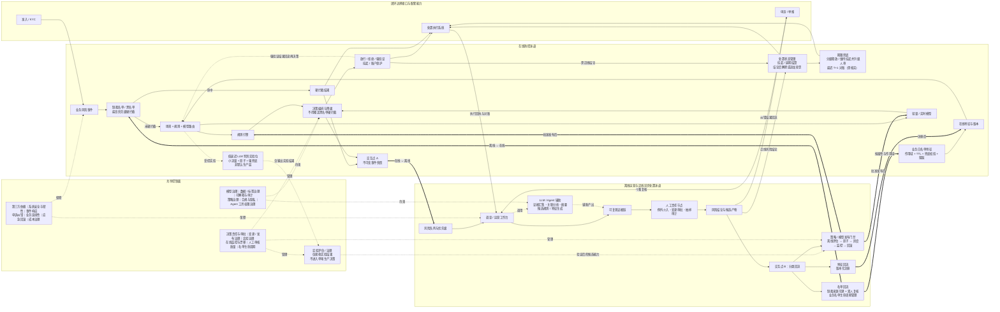
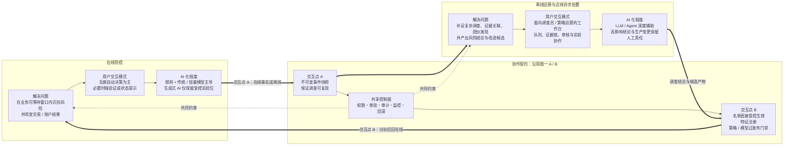

# AI 赋能风控产品形态：V2.1 架构方案

> 作品声明：本方案是个人产品能力作品，基于抽象业务场景与模拟数据，用于展示产品与架构判断；不代表作者曾在原公司主导、上线或运营该产品。既往风控经验仅作为问题理解的来源。

## 一、设计目标与范围

### 1. 设计目标

本方案把 AI 放在适合它的位置：在线侧优先保障确定性、时效和可追责，离线侧用 AI 提升调查、证据整理、策略发现和实验效率，再通过受控回流改善在线防控。整体采用“两条执行泳道 + 一个共享控制面”，而不是把在线防控与离线运营描述为风控工作的全部。

具体目标如下：

1. **稳住在线决策热路径**：按场景、规则和模型路由完成拦截、验证或处置，不把生成式 LLM 或开放 Agent 作为默认实时决策层。
2. **放大离线调查与运营能力**：让 LLM/Agent 辅助证据汇集、实体关联、案件摘要、候选策略与特征生成，但不自主执行高风险生产动作。
3. **形成可控的双向闭环**：在线向离线传递不可变事件快照；离线产出的名单、特征、策略与模型按不同风险等级回流。
4. **把治理做成共享产品能力**：统一承载版本、权限、审批、发布、监控、审计、回滚和成本治理，避免 AI 能力游离于现有风控责任体系之外。
5. **为完整风险生命周期留接口**：准入、处置执行、申诉和举报不在本作品中展开实现，但在架构中保留闭环边界接口及回流位置。

### 2. 本方案范围

| 范围 | 内容 |
|---|---|
| 方案内 | 交易或账户风险事件的在线识别与处置、近线异步处置、离线调查与策略运营、AI 辅助工作流、交互点 A/B、共享控制面、闭环边界接口留位 |
| 只留实验位 | 已命中中风险的小流量、低延迟 LLM 判别实验；本期仅影子运行，结果进入实验评估/治理，不进入单笔生产决策。未来是否进入真实业务及其强兜底条件（需核实） |
| 不展开实现 | 准入/KYC、处置执行系统、申诉与举报系统的内部产品流程；仅定义其与本架构的边界关系 |
| 显式排除 | 让生成式 LLM 逐笔自由推理；开放 Agent 自主放行、拒绝或下发处置；Agent 直写生产规则、生产名单、训练标签、人审结论或自身权限；真实生产数据和不可逆生产动作；AI 发起交易、合成身份、深度伪造 KYC 等 Agent 原生风险。本期不展开此类风险，但作为需监控趋势留痕 |

时延仅用于说明业务可等待窗口，不作为本方案的重点：秒内适合拦截型决策，秒至分钟适合仍可改变结果的近线处置，小时级及以上适合调查、团伙发现、策略挖掘和 Agent 实验。具体预算、阈值及适用场景（需核实）。

## 二、图一《AI 风控产品架构图》

### 图一说明

- **在线防控泳道**从业务事件开始，先经过制裁名单/黑名单这一独立最高优先级闸门，再由“场景 + 规则 + 模型”路由完成决策。业务白名单不等于直接放行，而是作为带作用域和 TTL 的特征参与路由，命中后仍经过兜底校验并全量留痕。
- **黑名单硬拦截不可降级**：`DECIDE` 的超时、依赖失败或模型不可用降级仅适用于通过硬拦截闸门后的路径，不得覆盖、旁路或撤销已命中的黑名单硬拦截。
- **实验结果不进入生产决策**：低延迟 LLM 影子实验只把结果送入“实验评估/治理”；验证后的候选能力仍须经过发布门禁，不能影响当前单笔交易的 `DECIDE`。
- **离线运营与近线异步处置泳道**接收在线快照，完成人机协作调查、证据链整理、风险结论和候选产物生成。LLM/Agent 是辅助者，不是最终责任主体；需要人工承担例外处理、变更审批和抽样审计责任。
- **共享控制面**同时约束两条泳道，覆盖模型、数据、策略、权限、审批、发布、监控、漂移、实验、名单生命周期、韧性、纠错、回滚和成本等治理事项。
- **两条泳道不是孤立系统**：交互点 A 把在线事件变为可复现的离线调查输入；交互点 B 把调查与运营成果按风险分级送回在线。处置结论还会回到挂起状态，触发解除或追加处罚。
- **近线档位有明确归属**：约 10 秒至 1 分钟的多源聚合、图计算及风险结论在“离线运营与近线异步处置泳道”运行，结论回写处置状态；具体时间预算与适用场景（需核实）。
- **闭环边界接口**显式保留准入/KYC、处置执行、申诉/举报。处置执行需要回执对账，申诉结论需要纠错回流，准入事件可复用统一的风险路由能力；其内部实现不属于本版展开范围。

## 三、图二《在线防控 ↔ 离线运营 协作与 AI 化程度图》

### 六维对照表

| 必答问题 | 在线防控 | 离线运营与近线异步处置 | 两者如何协作 |
|---|---|---|---|
| **各自解决什么问题？** | 在业务动作完成前或仍可改变结果的窗口内，完成风险识别、拦截、验证、挂起或账户保护 | 处理在线侧难以充分解释的复杂案件，完成多源证据关联、疑难初判、团伙发现、策略挖掘和运营复盘 | 在线通过 A 提供当时事实；离线通过 B 把结论和候选产物转成在线能力 |
| **适合什么用户交互模式？** | 面向消费者、商户或业务系统，以低打扰的自动决策为主；需要用户参与时使用强验证、挂起提示、处置结果通知和申诉入口 | 面向调查员、策略运营、模型与审批人员，以队列化工作台为主；支持证据浏览、AI 辅助问答、差异比较、人工审批和实验观察 | 用户侧感知的是决策与处置；专业用户侧看到的是可复现证据、责任节点和变更过程 |
| **AI 化到什么地步？** | 规则与传统/轻量模型可直接参与生产决策；生成式 LLM 只保留受控实验位，开放 Agent 不进入实时热路径 | LLM/Agent 可深度参与证据汇集、关联提示、摘要、优先级建议及候选规则/特征生成；不得自主发布或下发高风险动作 | AI 可以扩大分析与生产候选的能力，但最终生产权由分级门禁、人工责任和共享治理控制 |
| **数据新鲜度** | 使用事件发生时的实时/准实时特征与已发布版本，优先保证一致性和可复现 | 使用不可变事件快照，并追加近线多源信息、历史数据与关联证据；追加信息不得覆盖原快照 | A 固化在线当时事实；离线新增证据带时间和来源，再由 B 回流版本化产物 |
| **规模与成本** | 面向高并发逐笔决策，严格控制延迟、算力和外部依赖成本 | 面向筛选后的风险队列，可接受更高单案计算和人工成本；批量任务需配额与成本治理 | 在线先分流，离线按优先级投入资源；回流前评估新增能力的收益、时延和成本（需核实） |
| **触发机制** | 由交易、账户操作或准入等业务事件同步触发；必要时转入挂起后的近线流程 | 由在线快照、风险队列、定时批处理、案件复核或监控异常触发 | A 触发调查与近线计算；B 仅按名单、特征、策略/模型各自门禁回到在线 |

### 图二说明

图二及对照表从“问题、交互模式、AI 化程度、数据新鲜度、规模与成本、触发机制”六个维度解释分工。在线防控强调低打扰、确定性和及时改变业务结果；离线侧强调专业工作台中的复杂分析与人机协作。两者通过与图一同一套 A/B 契约形成闭环，因此图二是图一的协作视图，而不是另一套独立架构。

AI 化程度不是简单的“在线低、离线高”，而是**权限不同**：在线的规则和轻量模型可以在约束下直接执行；离线的生成式 AI 可以更深入地分析和生成候选，但对真实用户或生产系统产生影响前，必须经过人工责任节点和发布门禁。

## 四、交互点 A 与 B 的机制

### 1. 交互点 A：在线 → 离线

交互点 A 传递的是**不可变事件快照**，粗粒度包含事件、特征版本、决策上下文、分数和分流标签。它解决两个问题：一是让调查员看到“当时系统凭什么做决定”，二是让历史回放、复核和审计使用同一证据基线。

离线侧不得通过实时回查覆盖或改写当时证据。后续补充信息应作为新证据追加，并与原始快照区分，从而避免因特征、模型或数据变化造成不可复现。

### 2. 交互点 B：离线 → 在线

交互点 B 不提供一个可以任意直写线上的统一通道，而是按产物性质分治：

| 回流类型 | 生效机制 | 核心约束 |
|---|---|---|
| 名单 | 制裁名单经来源校验与双人复核后受控生效；业务名单经生命周期管理后受控生效 | 制裁名单来源可溯，且不经 Agent 自动回流；业务名单保留创建、审批、作用域、TTL、复核、撤销与回滚记录。黑名单进入独立硬拦截闸门，业务白名单按作用域进入特征层 |
| 特征 | 经特征平台版本化注册后供在线路由使用 | 保留口径、版本和适用场景；不得以临时候选替换线上特征 |
| 策略 / 模型 | 离线评估 → 影子 → 灰度 → 监控 → 回滚 | 禁止直写生产；影响真实用户前须人工批准，高风险规则扩量前再次确认 |

Agent 的标准发布闭环是：提出候选规则及证据 → 静态检查/冲突检测 → 历史回放 → 沙箱/影子 → 人工批准 → 小流量灰度 → 监控与回滚。禁止 Agent 直写生产规则或名单、下发处置指令、写入训练数据/标签、改写人审结论以及授予自身权限。

## 五、处置机制

处置型防控用于“风险结论尚未完全确定，但业务仍存在可控等待窗口”的场景。部分交易可以先进入**挂起**状态，也可以施加**延期结算处罚**；待近线调查或风险结论完成后，再选择：

- **解除**：证据不足或风险消除时，解除挂起或相关处罚，并保留决策和解除记录。
- **追加处罚**：风险得到进一步验证时，追加与场景和影响等级相匹配的处置；具体动作、阈值和审批层级（需核实）。

近线结论不得无限等待。采用分级超时兜底：制裁名单/黑名单硬拦截不适用自动释放；高风险或大额事件在结算期限到达时维持挂起并升级人审；其余事件若近线结论未在最晚结算期限前返回，则自动释放并保留事后追查标记。各场景的风险分级、金额线和最晚结算期限（需核实）。

处置不是只写入一个结论：指令下发后必须接收执行回执并对账，防止“已判定但未执行”。执行回执应实时或分钟级确认，批量对账最迟 T+1 完成；回执缺失或账实不符应进入异常队列并升级处理，具体口径和 SLA（需核实）。人工介入按“场景 × 金额/影响”分级，具体分级标准（需核实）。支付等高吞吐场景可以不逐单人审，但人工责任仍应位于规则上线、灰度扩量、例外介入和事后申诉复核等节点。

## 六、闭环边界接口留位

| 边界能力 | 本架构中的留位 | 本版边界 |
|---|---|---|
| 准入 / KYC | 向统一事件与路由入口提供准入风险事件，减少准入与事中口径割裂 | 不设计其内部流程、字段和外部服务接口 |
| 处置执行 | 接收放行、拒绝、验证、挂起、账户保护及处罚状态；回传执行回执供对账 | 不定义具体执行系统、处罚枚举和时效承诺 |
| 申诉 / 举报 | 将申诉、举报送入复核工作台；把纠错结果回流，避免误伤持续和标签失真 | 不设计客服、工单或监管报送流程 |

这些能力是风险生命周期的闭环边界，不是可忽略的“外围模块”。本作品选择不展开，是为了维持架构粗粒度，而非否定其重要性。

## 七、关键设计取舍

1. **以业务场景路由替代模型串行漏斗**：规则、传统模型和必要的图/时序能力可以并行或按场景选择，避免把“排白 → 小模型 → 大模型 → Agent”固化成普遍顺序。
2. **把生成式 AI 的默认价值押在异步侧**：证据汇集、关联分析、摘要、候选规则与历史回放更能发挥 LLM/Agent 优势，也更容易保留复现、审批和审计链条。
3. **在线热路径保留实验位，但不预设生产化**：允许验证低延迟判别器的未来价值，同时明确小流量、影子、强兜底和实验边界（需核实），不用实验假设污染默认架构。
4. **白名单下沉、黑名单独立**：业务白名单作为特征参与决策，减少全局放行造成的绕控；制裁名单/黑名单保持最高优先级硬拦截，以满足确定性控制需求。
5. **回流按风险分治**：名单、特征、策略/模型的变更半径不同，不能共享同一生效权限；尤其策略/模型必须经过完整发布门禁。
6. **人工不必逐单，但必须承担责任**：用例外介入、变更审批和抽样审计覆盖不同风险层级；在高吞吐场景中把人工放在真正能控制系统性风险的位置。
7. **证据与执行都要闭环**：A 保证证据不被事后改写，执行回执保证处置没有停留在“系统认为已完成”，申诉纠错保证误伤不会长期固化。
8. **共享控制面不是展示性附录**：AI 是否可用，取决于权限、版本、审批、监控、漂移、回滚和成本能否共同运行；具体监管要求、真实业务阈值和生产时延（需核实）。
