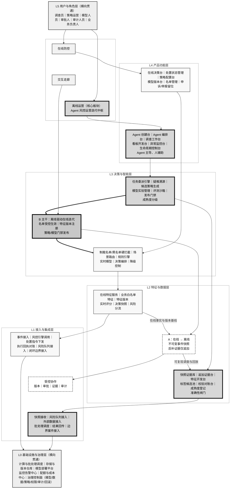
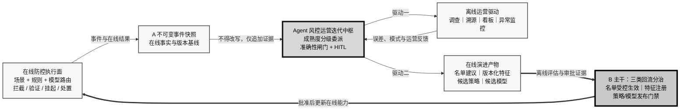

# 离线核心板块：Agent 主导运营与在线规则模型迭代 V3

> 作品声明：本方案是个人产品能力作品，基于抽象业务场景与模拟数据，用于展示产品与架构判断；不代表作者曾在原公司主导、上线或运营该产品。既往风控经验仅作为问题理解的来源。

## 一、设计目标与本版范围

### 1. 设计目标

本版把重心移到离线侧，建设一个能够持续生产运营结论与防控能力的核心板块。在线防控仍是确定性的执行面；离线侧以 Agent 为主要生产力、以人为责任与例外处理主体，通过受控的交互点 B 驱动在线规则与模型迭代。

具体目标如下：

1. **形成离线动力源**：把调查、溯源、看板开发、异常监控、策略发现和模型实验收敛到统一核心板块，而非把离线侧定位为被动案件处理端。
2. **建立双重驱动**：同一套证据、Agent、评测与治理能力，一端驱动离线运营闭环，另一端持续产出名单、特征、策略与模型候选，赋能在线防控。
3. **把交互点 B 升级为主线**：名单受控生效、特征版本化注册、策略/模型门禁发布三路分治；其中策略/模型迭代是核心板块驱动在线演进的主干。
4. **实行分级委派**：成熟、可标准化、可校验的任务由 Agent 主导；复杂或疑难任务由 Agent 与人协作；高影响判断与生产变更保留人工责任。
5. **使 Agent 可产品化运营**：覆盖创建、测评、上线、迭代与退役，做到能力、权限、版本、质量和成本均可管理。

### 2. 范围与边界

| 范围 | 本版处理方式 |
|---|---|
| 方案内 | 离线运营工作台、Agent 任务编排、成熟度分级、准确性闸门、Agent 生命周期、工具与 Skill、交互点 A/B、在线规则与模型的受控迭代 |
| 在线侧 | 保留场景 + 规则 + 模型路由、制裁名单/黑名单硬拦截、在线特征、决策与处置；生成式 LLM/开放 Agent 不进入默认实时热路径 |
| 闭环留位 | 准入/KYC、处置执行、申诉/举报作为边界能力保留；不展开其内部产品流程 |
| 显式排除 | Agent 直写生产规则或名单、下发处置指令、写入训练数据/标签、改写人审结论、授予自身权限；真实生产数据与不可逆生产动作 |
| 本轮不展开 | 监管制度映射、具体字段/接口/表结构、供应商选型、费率、生产阈值与 SLA；具体口径均需结合业务核实 |

## 二、核心板块定义与命名

### 1. 正式命名

核心板块命名为 **“Agent 风控运营迭代中枢”**，简称 **“运营迭代中枢”**。

“运营”对应调查、溯源、看板、异常监控和运营复盘；“迭代”对应特征、策略与模型候选的发现、验证及受控回流；“中枢”强调它统一调度 Agent、证据、评测和发布门禁，但不取代在线风控引擎，也不等同于完整风控体系。

### 2. 板块定义

运营迭代中枢是位于离线侧的产品化能力集合。它接收交互点 A 的不可变事件快照及后续追加证据，按任务成熟度编排 Agent 与人工协作，生产两类结果：

- **离线运营结果**：案件初判、疑难溯源、异常归因、监控结论、看板与运营复盘。
- **在线演进产物**：名单建议、版本化特征、候选策略与候选模型；经交互点 B 分治后，才可成为在线能力。

它的核心公式是：**委派 = 可验证的 Agent 能力 + 与影响等级匹配的准确性闸门**。Agent 主导的是标准化生产过程，不是生产权限和最终责任。

## 三、双重驱动机制

### 1. 驱动离线运营

运营迭代中枢把风险队列、不可变事件快照和追加证据组织成标准任务。成熟 Agent 可持续执行数据准备、案件预分析、看板生成、异常扫描、历史回放和报告草拟；人在例外、冲突、高影响结论及抽样审计节点介入。

离线运营闭环为：

**任务进入 → 成熟度识别 → Agent/人分工 → 证据化产出 → 准确性闸门 → 运营使用 → 误差回收**。

复杂疑难问题不会被强行自动化。Agent 负责扩展检索、聚合证据、提出假设和复现实验，人负责补充业务语境、判断证据冲突、确认结论边界及承担最终责任。随着任务模板、评测集和校验规则成熟，可将任务从人主导逐步升级为受监督委派。

### 2. 驱动在线规则与模型迭代

离线运营不是闭环终点。案件、异常和监控结果沉淀为可复现证据，再转化为特征、策略与模型候选。运营迭代中枢统一完成候选生成、历史回放、离线评估、冲突检查和发布准备，由交互点 B 送入不同生效通道。

| B 回流类型 | 中枢产出 | 在线生效方式 | 不可跨越的边界 |
|---|---|---|---|
| 名单 | 有来源、证据和作用域的名单建议 | 经对应生命周期与审批受控生效 | 制裁名单须来源可溯、双人复核，且不得由 Agent 自动回流；黑名单进入独立最高优先级硬拦截 |
| 特征 | 定义清晰、可复现的候选特征 | 经版本化注册后供场景路由使用 | 临时候选不得替换在线版本；业务白名单按作用域、TTL、兜底校验和留痕进入特征层 |
| 策略/模型 | 候选规则、候选模型及评估证据 | 离线评估 → 影子 → 灰度 → 监控 → 回滚 | 禁止直写生产；真实用户受影响前须完成人工审批与发布门禁 |

交互点 B 因此不是“调查后的辅助回流”，而是 **运营迭代中枢向在线防控持续供给已验证能力的主干**。在线效果、异常和处置结果再通过交互点 A 固化为新一轮不可变事实，形成可测量的演进循环。

### 3. 交互点 A：事实基线

交互点 A 从在线向离线传递不可变事件快照，粗粒度包含事件、特征版本、决策上下文、分数和分流标签。离线不得通过实时回查覆盖当时证据；后补信息只能作为带来源和时间的追加证据。

A 同时承担两项作用：为案件调查提供可复现起点；为规则与模型迭代提供与当时在线版本一致的回放基线。

## 四、分层能力架构图

### 图示解读

- **纵轴 L0-L5**：L0 和 L5 分别以基础治理能力和用户责任横向贯通；L1-L4 保持在线、离线两根竖柱，表达由基础能力向产品使用层逐级支撑，而非逐笔数据流。
- **在线柱**：保持确定性执行职责。制裁名单/黑名单位于独立硬拦截节点；业务白名单位于特征层；规则与实时模型按场景路由，不形成“排白 → 小模型 → 大模型 → Agent”的串行漏斗。
- **离线柱**：以更深底色和更粗边框突出运营迭代中枢。L2 放准确性与成熟度基础，L3 放委派、智能分析、评测和发布门禁，L4 放面向运营人员的 Agent 产品功能。
- **中央走廊**：A 把在线事实送入中枢；B 把中枢验证后的候选能力送回在线。B 使用加粗主干，明确本版“离线驱动在线规则模型迭代”的重心。
- **箭头含义**：柱内箭头表示层间依赖；柱间箭头表示受控交互契约，不表示 Agent 拥有线上直写权限。

## 五、工作分工矩阵：按成熟度委派

### 1. 成熟度等级

| 等级 | 任务状态 | 默认分工 | 升级条件 |
|---|---|---|---|
| M0 探索 | 问题边界不清、证据口径不稳定、难以形成标准答案 | **人主导**；Agent 辅助检索、整理和提出假设 | 形成任务契约、样例集、结果标准和失败分类 |
| M1 协作 | 流程可描述，但复杂例外或判断依赖较多 | **Agent + 人**共同完成；人确认关键证据与结论 | 在代表性样本上稳定通过评测，主要例外可识别并升级 |
| M2 监督委派 | 输入、步骤、输出和校验规则已标准化 | **成熟 Agent 主导**；人处理例外、审批并抽样 | 多轮运行质量稳定、可对账、可回滚，权限边界验证通过 |
| M3 受控自治 | 高频、低歧义、低影响且已有持续监控的任务 | **成熟 Agent 持续执行**；人按异常与抽样介入 | 仅限授权的离线任务；不得越过交互点 B 的人工与发布门禁 |

成熟度是“任务 × Agent 版本 × 使用场景”的组合属性，不是对某个 Agent 的永久评级。输入分布、工具版本或业务口径变化后，应重新评测；不能沿用旧等级自动扩权。

### 2. 任务分工

| 工作 | 建议成熟度 | 主导方式 | Agent 责任 | 人的责任 | 主要准确性闸门 |
|---|---:|---|---|---|---|
| 常规异常扫描与告警归并 | M2-M3 | 成熟 Agent 主导 | 执行固定监控、聚类重复告警、生成证据摘要 | 处理高影响异常与规则外事件 | 基线对比、重复校验、漏报抽样、告警对账 |
| 标准运营看板开发与刷新 | M2 | 成熟 Agent 主导 | 按已批准口径生成查询、图表和说明 | 批准指标口径，复核首次发布和重大变更 | 口径校验、总分对账、时间窗校验、样本复算 |
| 案件预分析与证据整理 | M2 | 成熟 Agent 主导 | 基于快照组织事实、关联证据并标出冲突 | 复核例外与高影响结论 | 来源引用、快照一致性、事实/推断分离、抽样复核 |
| 疑难问题溯源 | M0-M1 | Agent + 人 | 扩展检索、生成假设、执行回放、记录反证 | 选择假设、补充语境、确认根因与影响边界 | 多证据交叉验证、反例检查、可复现回放、专家复核 |
| 候选特征发现 | M1-M2 | Agent + 人 | 提出候选、完成历史计算与稳定性分析 | 确认业务含义、泄漏风险和适用场景 | 特征口径审查、时间穿越检查、版本注册、影子验证 |
| 候选规则生成与冲突分析 | M1 | Agent + 人 | 从案例归纳候选逻辑、执行静态检查和历史回放 | 判断业务合理性、批准进入实验 | 冲突检测、误伤样本、回放对账、发布门禁 |
| 候选模型实验与比较 | M1-M2 | Agent + 人 | 组织实验、比较版本、输出局限与失败样本 | 决定实验设计、上线候选及扩量 | 数据隔离、基准集、稳定性检查、影子与灰度观察 |
| 名单建议与证据整理 | M1-M2 | Agent + 人 | 汇总来源、证据与作用域，形成建议 | 完成审批；制裁名单执行双人复核 | 来源可溯、重复/冲突校验、生命周期检查 |
| 生产规则/模型发布 | 不适用 M3 | 人主导 | 准备评估材料、监控方案与回滚预案 | 批准、发布和扩量决策 | 离线评估、影子、灰度、监控、回滚 |
| 高影响个案结论与例外处置 | M0-M1 | 人主导 | 提供证据摘要、相似案例和不确定性 | 作出结论并承担责任 | 双重检查、证据链、操作留痕、事后抽审 |

表中成熟度区间的实际升降标准、任务影响分级和抽样比例 **(需核实)**。

## 六、准确性把控机制

准确性不以“模型回答看起来合理”为判断标准，而以任务是否可验证、输出是否可追溯、结果是否能与独立事实对账为准。

### 1. 五类准确性闸门

| 闸门 | 机制 | 失败后的动作 |
|---|---|---|
| 输入闸门 | 校验快照完整性、版本一致性、来源可用性和追加证据边界 | 缺失或冲突时停止自动结论，转异常队列或人工补证 |
| 过程闸门 | 工具白名单、只读优先、步骤留痕、固定任务模板、权限最小化 | 越权调用或步骤缺失即中止任务并告警 |
| 输出闸门 | 结构校验、业务规则校验、事实/推断/未知分离、证据引用、置信状态 | 不合格输出不得进入运营使用或 B 回流候选池 |
| 对账闸门 | 看板总分与明细复算、告警与原始事件核对、回放结果与基准版本比较 | 差异进入误差分析，不允许以 Agent 自解释替代对账 |
| 人工闸门 | 例外介入、变更审批、分层抽样审计 | 高影响或低置信任务升级；系统性误差触发降级、停用或回滚 |

### 2. 按任务定义“正确”

- **看板开发**：指标口径一致、筛选范围正确、汇总与明细可对账、图表说明不超出数据证据。
- **异常监控**：告警可回指原始事实，重复告警可识别，漏报通过独立样本抽查，漂移能够触发复评。
- **案件分析**：事实、推断与未知分开；关键结论有证据；后补信息不覆盖原快照；另一执行者可复现。
- **疑难溯源**：至少保留候选假设、支持证据、反证与排除过程；无法确认时明确输出“未核实”，不强行归因。
- **策略/模型候选**：相对当前基线有可复核比较，失败样本和影响范围被揭示，并具备影子、灰度、监控和回滚条件。

具体评测阈值、抽样比例、告警容忍度和上线标准 **(需核实)**；在这些标准确认前，不把任务升级到 M3。

### 3. 三层 HITL

1. **例外介入**：低置信、证据冲突、高影响或超出任务契约时，由人接管。
2. **变更审批**：工具权限、Skill、任务模板、特征、策略、模型及名单的生效变更由相应责任人批准。
3. **抽样审计**：对已委派任务按风险分层抽样，不以逐单人审抵消自动化收益；发现系统性误差时扩大样本并降级任务成熟度。

## 七、Agent 生命周期：创建 → 测评 → 上线 → 迭代

| 阶段 | 核心动作 | 交付物 | 准入/退出门禁 |
|---|---|---|---|
| 创建 | 定义任务契约、适用场景、输入/输出、证据要求、工具与 Skill 白名单、权限边界、人工责任人、目标成熟度 | Agent 说明、任务模板、权限清单、失败与升级规则、版本记录 | 未定义可验证结果、人工负责人或禁区时不得进入测评 |
| 测评 | 在沙箱使用历史/模拟样本，覆盖标准样本、边界样本、对抗样本、工具失败、权限越界与成本时效；与人工或确定性基线比较 | 评测报告、失败分类、误差样本、可复现记录、建议成熟度 | 准确性、权限、稳定性或可复现性未达标准时返回创建阶段；具体阈值 (需核实) |
| 上线 | 先影子运行，再限定任务/队列/权限受监督开放；配置监控、抽样、暂停开关、降级与回滚；指定值守责任 | 上线审批、运行看板、抽样计划、回滚预案、责任人 | 仅授予通过评测的最小权限；离线 Agent 上线不等于获得在线生产写权限 |
| 迭代 | 汇总误差、人工纠正、分布漂移和工具变更；更新任务模板、Skill 或模型；重新回归评测并升降成熟度 | 新版本、差异说明、回归报告、成熟度变更、退役记录 | 能力扩展或权限变化必须重新审批；持续退化、失去负责人或无法复现时降级/停用 |

生命周期中的“上线”指 Agent 在授权的离线任务范围内投入运行。Agent 产出的策略或模型仍须单独经过交互点 B 的发布门禁，二者不能合并审批。

## 八、工具与 Skill 清单

工具解决“Agent 能调用什么”，Skill 解决“Agent 按什么方法完成任务”。两者都需版本化、最小授权、可观测和可撤销。

### 1. Tools：执行能力

| 工具类别 | 粗粒度能力 | 主要用途 | 默认边界 |
|---|---|---|---|
| 数据访问工具 | 只读查询、样本提取、版本定位、数据质量检查 | 看板、监控、案件分析、回放 | 默认只读；不得直写训练标签或生产数据 |
| 分析计算工具 | 批处理、统计分析、图关联分析、时间序列分析 | 异常发现、团伙线索、疑难溯源 | 结果是分析证据或候选，不直接变更处置 |
| 看板与报告工具 | 图表生成、指标说明、报告编排、差异比较 | 看板开发、运营复盘、评测报告 | 首次发布和口径变更需人工复核 |
| 监控告警工具 | 指标巡检、漂移检测、异常聚合、通知与升级 | 日常监控、Agent 质量监控 | 告警阈值与升级对象由人批准 (需核实) |
| 调查取证工具 | 快照阅读、证据索引、实体关系浏览、时间线重建 | 案件预分析、复杂溯源 | 后补证据只能追加，不得改写原始快照 |
| 实验评测工具 | 历史回放、基准集评测、影子比较、灰度观察 | Agent 测评、策略/模型候选验证 | 不提供绕过发布门禁的生产入口 |
| 版本与治理工具 | 版本登记、审批流、权限控制、审计、回滚、成本计量 | 生命周期和交互点 B 管理 | Agent 不得自授予权限或自批准变更 |
| 协作工具 | 任务队列、人工接管、评论、证据签认、问题追踪 | Agent + 人协作及例外处置 | 高影响结论必须绑定明确责任人 |

### 2. Skills：方法能力

| Skill 类别 | 应具备的方法 | 典型产物 |
|---|---|---|
| 数据看板开发 | 指标拆解、口径核对、查询审查、可视化选择、明细对账、结论边界表达 | 可复核看板、口径说明、对账结果 |
| 异常监控 | 基线建立、变化检测、告警归并、影响评估、误报/漏报复盘、升级判断 | 异常清单、证据摘要、优先级建议 |
| 疑难溯源 | 问题定义、证据树、假设生成、反证检查、时间线重建、根因边界 | 可复现调查记录、候选根因、未核实项 |
| 案件调查 | 快照解读、证据关联、相似案例比较、冲突识别、事实/推断分离、交接摘要 | 案件预分析、证据链、人工接管包 |
| 策略与特征发现 | 风险模式归纳、候选逻辑表达、冲突检查、历史回放、影响面分析、回滚设计 | 候选规则、候选特征、评估证据 |
| 模型实验 | 基线设计、样本分层、失败样本分析、稳定性比较、影子观察、灰度复盘 | 模型比较报告、上线建议与局限 |
| 质量与安全 | 权限边界判断、输入/输出校验、工具失败处理、不确定性表达、审计留痕、升级/停用 | 校验记录、异常升级、审计证据 |

## 九、精简闭环图：双重驱动与 B 主线

这张图只表达两个闭环：一是中枢直接驱动离线运营并回收误差；二是中枢把运营证据转化为在线演进产物，经 B 主干受控更新在线能力。A 再把新的在线事实带回离线，因此 B 的驱动效果可以在下一轮被验证。

## 十、关键设计取舍与理由

1. **把核心板块定义为“运营迭代中枢”，而不是调查工作台**：调查只是输入到产出的一段；中枢必须同时拥有 Agent 编排、评测、准确性闸门和在线演进产物管理，才能成为动力源。
2. **在线保留执行权，离线获得迭代驱动力**：在线需要确定性、低延迟和可降级；离线适合使用 Agent 扩展分析与生产候选。两侧不是主次替代，而是“离线供给能力、在线受控执行”。
3. **以任务成熟度决定委派，而非以岗位决定委派**：同一调查员的常规看板可由 Agent 主导，疑难归因仍需共同完成；成熟后可以升级，分布变化后也能降级。
4. **准确性闸门前置到委派设计**：没有基准、校验、对账、抽样和升级路径的任务，不进入成熟委派；这避免把人工复核变成上线后的被动补救。
5. **Agent 生命周期与策略/模型发布生命周期分离**：Agent 能够上线执行离线任务，不代表其候选产物可以上线影响用户；交互点 B 始终保留独立门禁。
6. **B 分治而不提供统一写入口**：名单、特征、策略/模型的风险和生效方式不同。统一直写会模糊责任边界，也会放大 Agent 错误半径。
7. **黑白名单只保留必要位置**：图中保留制裁名单/黑名单独立硬拦截和业务白名单特征节点；本版不重复展开其完整生命周期。
8. **不预设具体厂商和生产数字**：真实数据源、平台能力、评测阈值、抽样比例、SLA 与成本标准均需结合组织现状核实。

## 十一、落地前待核实项

- 首批适合进入 M2 的标准任务、当前人工基线及代表性评测样本 **(需核实)**。
- 各类任务的正确性阈值、抽样比例、低置信升级规则和成熟度升降周期 **(需核实)**。
- 在线影子、灰度、回滚和处置回执能力的现状，以及现有责任人与审批边界 **(需核实)**。
- 可供 Agent 使用的数据、看板、监控、图分析和实验工具现状及最小权限方案 **(需核实)**。
- 准入/KYC、处置执行、申诉/举报与本中枢的实际边界和协作责任 **(需核实)**。
