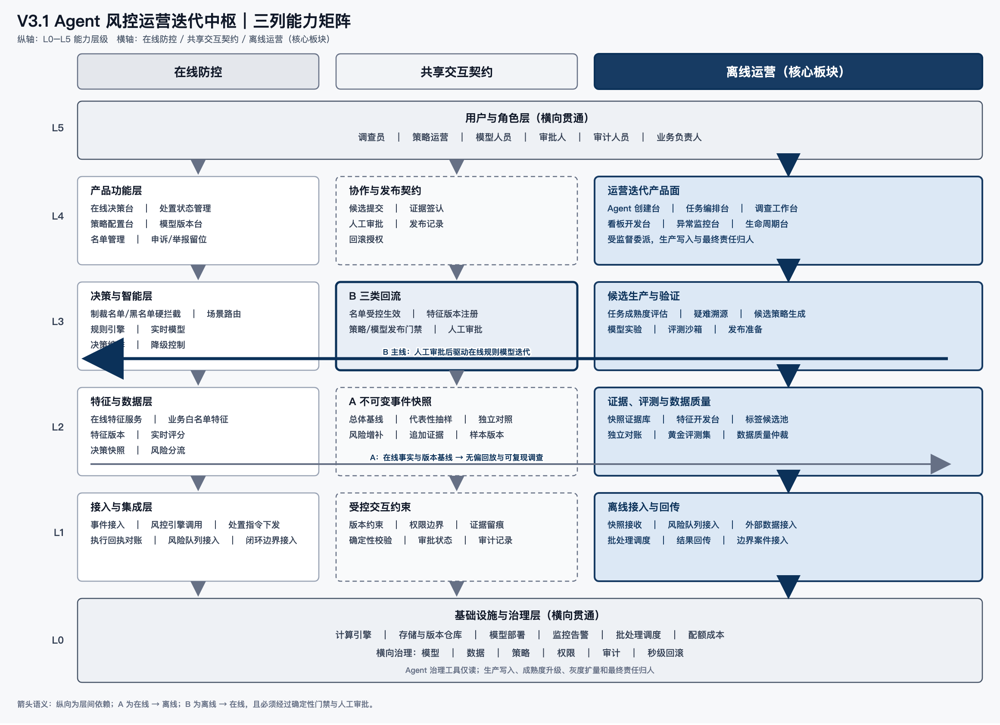
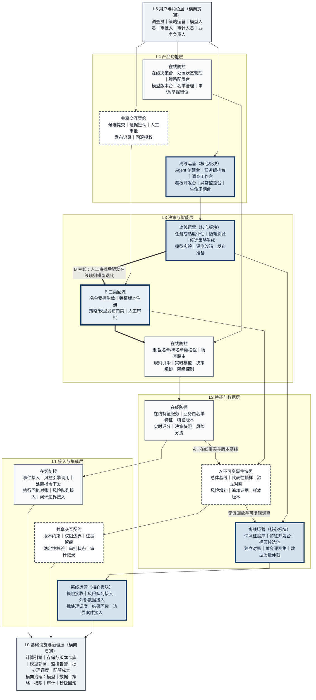
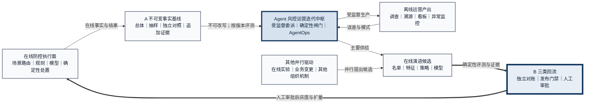

# 离线运营迭代中枢与在线规则模型演进 V3.1

> 作品声明：本方案是个人产品能力作品，基于抽象业务场景与模拟数据，用于展示产品与架构判断；不代表作者曾在原公司主导、上线或运营该产品。既往风控经验仅作为问题理解的来源。

## 一、设计目标与本版范围

### 1. 设计目标

本版建设“Agent 风控运营迭代中枢”：在线防控保持确定性执行，离线运营作为在线能力演进的主要供给方，通过共享交互契约 A/B 形成可回放、可评测、可审批、可回滚的迭代闭环。

具体目标如下：

1. **形成离线主要供给能力**：把调查、溯源、看板、异常监控、特征与策略发现、模型实验收敛到统一中枢；同时承认在线实验、业务直改和其他组织机制可并行驱动在线变化。
2. **建立双重产出**：同一套证据、Agent、评测与治理能力，一端服务离线运营，另一端生产名单、特征、策略与模型候选。
3. **把 A/B 升为共享交互契约**：A 提供无选择偏差的在线事实基线；B 对三类候选分治，并以“人工审批后的策略/模型发布”作为主线。
4. **实行分级委派**：标准化、可校验任务可由 Agent 受监督主导；复杂任务由 Agent 深度辅助；最终结论、成熟度升级、灰度扩量和生产变更由人负责。
5. **使 Agent 可产品化运营**：覆盖创建、测评、上线、迭代和退役，并纳入确定性闸门、AgentOps 可观测性、权限隔离、成本配额与版本回归。

**边界声明：Agent 主导 ≠ 拥有生产权/最终责任。** 本文后续仅使用“受监督主导”或“深度辅助”描述 Agent 的工作方式；生产写入、最终审批与责任归属始终属于明确的人类角色。

### 2. 范围与边界

| 范围 | 本版处理方式 |
|---|---|
| 方案内 | 离线运营工作台、Agent 编排、成熟度分级、确定性准确性闸门、Agent 生命周期、AgentOps、工具与 Skill、交互点 A/B、在线规则与模型受控迭代 |
| 在线侧 | 保留场景路由、规则、实时模型、制裁名单/黑名单硬拦截、在线特征、决策与处置；生成式 LLM/开放 Agent 不进入默认实时热路径 |
| 闭环留位 | 准入/KYC、处置执行、申诉/举报作为边界能力保留；不展开内部产品流程 |
| 显式排除 | Agent 直写生产规则、模型、名单、阈值或标签；下发生产处置；改写人审结论；自授予权限；自改任务契约、评测集或成熟度 |
| 安全留位 | Agent 原生安全、多 Agent 身份与委派链、跨 Agent 数据边界、相互调用和故障传播边界；本版只留能力位，不展开方案 |
| 本轮不展开 | 监管制度映射、字段/接口/表结构、供应商选型、费率、生产阈值与 SLA；具体口径均需结合业务核实 |

### 3. 立项前置条件

以下不是上线后的优化项，而是进入实施立项前必须被证明可用的条件：

- 在线规则、模型、特征和名单具备明确版本，可定位任一时刻的生效组合。
- 在线发布支持影子、灰度、暂停和**秒级回滚能力**；实际回滚目标、覆盖范围和演练结果 **(需核实)**。
- 处置结果、执行回执和版本基线可对账，失败时有确定性降级路径。
- 生产写权限与 Agent 执行身份隔离，所有 B 回流必须经过人类审批和现有发布门禁。

任一条件缺失时，只允许开展隔离沙箱中的研究和原型验证，不进入真实用户受影响的灰度阶段。

## 二、核心板块定义

核心板块正式命名为 **“Agent 风控运营迭代中枢”**，简称 **“运营迭代中枢”**。

它是位于离线侧的产品化能力集合：接收 A 的不可变快照及追加证据，按任务成熟度编排 Agent 与人工协作，产出两类结果：

- **离线运营结果**：案件预分析、疑难溯源、异常归因、监控结论、看板和运营复盘。
- **在线演进候选**：名单建议、版本化特征、候选策略和候选模型；只有通过 B 的分治、确定性门禁和人工审批后，才可进入在线发布流程。

其委派原则是：**可委派程度 = 可验证能力 × 影响等级约束 × 确定性闸门完备度**。Agent 承担的是受监督的标准化生产过程，不拥有生产权，也不承担最终责任。

## 三、双向演进与共享交互契约

### 1. 离线运营与在线演进

离线运营闭环为：

**任务进入 → 成熟度识别 → Agent/人分工 → 证据化产出 → 确定性闸门 → 人工使用或审批 → 误差回收**。

标准任务可由成熟 Agent 受监督主导数据准备、案件预分析、看板生成、异常扫描、历史回放和报告草拟；疑难问题由 Agent 深度辅助检索、证据聚合、假设与反证，人负责补充语境、判断冲突、确认边界及承担责任。

离线中枢是在线能力演进的**主要供给方，而非唯一驱动源**。在线实验、业务直改及其他组织机制可并行提出变化；无论候选来自何处，只要进入本方案覆盖的发布路径，都应使用同一版本、证据、审批、监控与回滚标准。

### 2. 交互点 A：不可变事实与无偏评估基线

A 从在线向共享契约列固化当时事件、特征版本、决策上下文、分数、分流标签及后续可获得的结果状态。后补信息只能带来源和时间追加，不得覆盖原快照。

为避免只采集“风险案件”造成选择偏差，A 的覆盖设计如下：

1. **总体基线**：原则上对所有进入在线决策范围的事件形成最小不可变快照，而非只保留命中、拦截或人工队列样本。实际全量留存范围和保留周期 **(需核实)**。
2. **代表性评测样本**：若受成本约束不能全量进入回放，则从总体基线按场景、时间、决策结果和风险分层做概率抽样，保留纳入概率与抽样版本；总体指标按抽样设计还原。具体分层和比例 **(需核实)**。
3. **独立对照组**：保留不由候选生成流程挑选的稳定对照样本，用于估计正常样本上的误伤及总体变化；对照组定义、规模和观察窗 **(需核实)**。
4. **风险增补集**：命中案件、边界案例和罕见风险可以增补用于诊断与召回评估，但不得直接替代总体样本计算误杀率或总体收益。
5. **标签成熟窗**：仅在结果观察充分后计算相应指标；未成熟、缺失或冲突状态单列，不由 Agent 猜测补齐。

回放评估必须同时报告总体样本、独立对照、风险增补集的结果与适用边界；固定时间外留、去重规则和基线版本。候选生成样本不得进入同版本的黄金评测集，避免“在已见案例上证明自己”。

### 3. 交互点 B：三类回流分治

| B 回流类型 | 中枢产出 | 受控生效方式 | 不可跨越的边界 |
|---|---|---|---|
| 名单 | 有来源、证据和作用域的名单建议 | 进入既有生命周期与人工审批后受控生效 | Agent 不得自动写入；制裁名单/黑名单保持在线硬拦截节点，本文不展开其生命周期 |
| 特征 | 可复现的候选特征及验证证据 | 人工确认后完成版本注册，再供场景路由使用 | 临时候选不得替换在线版本；业务白名单保留为在线特征节点，本文不展开 |
| 策略/模型 | 候选规则、候选模型、失败样本和评估证据 | 离线评估 → 影子 → 人工批准灰度及扩量 → 监控 → 必要时秒级回滚 | 禁止直写生产；Agent 不得决定灰度比例、阈值或扩量 |

B 的主线是：**离线中枢供给候选策略/模型 → 确定性评测与对账 → 人工审批 → 在线灰度与扩量**。A 再把新的在线事实带回下一轮评估，构成可测量演进循环。

## 四、三列分层能力矩阵

### 图示解读

- **纵轴 L0-L5**：L0、L5 横向贯通；L1-L4 是严格对齐的三列能力矩阵，表达能力分层而不是逐笔泳道数据流。
- **在线防控列**：负责确定性、低延迟和可降级执行；制裁名单/黑名单是独立硬拦截节点，业务白名单处于特征层。
- **共享交互契约列**：A/B 不再是图中两个附属点，而是独立一等能力列，承载样本基线、版本、证据、权限、确定性门禁与人工审批。
- **离线运营列**：以更宽幅、更深底色和粗边框突出运营迭代中枢；它是候选能力的主要供给方，但不是在线变化的唯一驱动源。
- **箭头**：纵向箭头表示层间依赖；A 表示在线事实进入离线；B 的加粗反向箭头表示“人工审批后驱动在线规则模型迭代”。任何箭头都不表示 Agent 拥有生产写权限。

## 五、按任务成熟度委派

### 1. 成熟度等级

| 等级 | 任务状态 | 默认分工 | 升级条件 |
|---|---|---|---|
| M0 探索 | 边界不清、证据口径不稳、难以形成标准答案 | 人主导；Agent 深度辅助检索、整理和提出假设 | 形成任务契约、样例集、结果标准和失败分类 |
| M1 协作 | 流程可描述，但复杂例外或判断依赖较多 | Agent 深度辅助；人确认关键证据与结论 | 在代表性样本上稳定通过评测，主要例外可识别并升级 |
| M2 监督委派 | 输入、步骤、输出和校验规则已标准化 | Agent 受监督主导；人处理例外、审批并抽样 | 多轮质量稳定、可对账、可回滚，权限边界验证通过，并由人批准升级 |
| M3 受控自治 | 高频、低歧义、低影响且持续监控的离线任务 | Agent 在授权边界内受监督持续执行；人按异常与抽样介入 | 仅限离线任务；升级与继续授权均须人工批准，不得越过 B |

成熟度是“任务 × Agent 版本 × 提示词版本 × 底层模型版本 × 使用场景”的组合属性，不是 Agent 的永久等级。输入分布、工具、提示词或底层模型变化后必须重新回归评测。

**禁止事项**：Agent 不得自升成熟度，不得修改自身任务契约或闸门阈值，不得修改或挑选黄金评测集，不得决定灰度比例或扩量。成熟度升级、灰度启动和每次扩量均由人基于独立证据批准。

### 2. 工作分工矩阵

| 工作 | 建议成熟度 | 工作方式 | Agent 责任 | 人的责任 | 主要确定性闸门 |
|---|---:|---|---|---|---|
| 常规异常扫描与告警归并 | M2-M3 | 受监督主导 | 执行固定监控、归并重复告警、生成证据摘要 | 处理高影响异常与规则外事件 | 基线差异、重复校验、漏报抽样、告警对账 |
| 标准运营看板开发与刷新 | M2 | 受监督主导 | 按批准口径生成查询、图表和说明 | 批准口径，复核首次发布和重大变更 | 口径规则、总分对账、时间窗校验、样本复算 |
| 案件预分析与证据整理 | M2 | 受监督主导 | 基于快照组织事实、关联证据并标冲突 | 复核例外与高影响结论 | 来源存在性、快照一致性、结构校验、抽样复核 |
| 疑难问题溯源 | M0-M1 | 深度辅助 | 扩展检索、生成假设、执行回放、记录反证 | 选择假设、补充语境、确认根因与影响边界 | 多源一致性、反例检查、可复现回放、专家复核 |
| 候选特征发现 | M1-M2 | 深度辅助 | 提出候选、完成历史计算与稳定性分析 | 确认业务含义、泄漏风险和适用场景 | 时间穿越检查、版本匹配、影子对账 |
| 候选规则生成与冲突分析 | M1 | 深度辅助 | 归纳候选逻辑、执行静态检查和历史回放 | 判断合理性、批准进入实验 | 冲突检测、误伤样本、回放对账、发布门禁 |
| 候选模型实验与比较 | M1-M2 | 深度辅助 | 组织实验、比较版本、输出局限与失败样本 | 决定实验设计、上线候选、灰度与扩量 | 数据隔离、固定基准、稳定性规则、影子对账 |
| 名单建议与证据整理 | M1-M2 | 深度辅助 | 汇总来源、证据与作用域，形成建议 | 完成审批和必要复核 | 来源可溯、重复/冲突校验、生命周期检查 |
| 生产规则/模型发布 | 不适用 M3 | 人主导 | 准备评估材料、监控方案与回滚预案 | 批准、发布、灰度和扩量 | 离线评估、影子、灰度、监控、回滚演练 |
| 高影响个案结论与例外处置 | M0-M1 | 人主导 | 提供证据摘要、相似案例和不确定性 | 作出结论并承担责任 | 双重检查、证据链、操作留痕、事后抽审 |
| 成本/配额约束 | M1-M2 | 受监督执行 | 记录 token、工具调用和任务成本，按批准配额运行并预警 | 设定预算与配额，批准临时扩容，权衡质量/时效/成本 | 配额硬限制、成本汇总对账、异常熔断 |
| 标签/数据质量归属与仲裁 | M0-M1 | 人主导、Agent 深度辅助 | 发现缺失、冲突、漂移并整理证据，不直接改标签 | 数据责任人定义口径；业务/模型责任人按既定机制仲裁 **(需核实)** | 来源校验、规则一致性、双人变更复核、版本留痕 |

实际升降标准、影响分级、抽样比例、配额和数据仲裁责任矩阵 **(需核实)**。

## 六、确定性准确性闸门

### 1. 实现原则

所有自动准确性闸门必须由**确定性代码或规则**执行；禁止“LLM 审 LLM”，也禁止用 Agent 的自我解释替代通过/失败判定。需要语义判断的样本由人形成批准的黄金答案或结构化判定标准，再由独立执行逻辑完成一致的比较。

对账闸门必须独立于被评测 Agent：使用隔离的计算路径、固定输入版本和可重复结果；Agent 不得修改对账逻辑、阈值、评测样本或最终判定。人工审批是独立责任动作，不是另一个 LLM 评委。

### 2. 五类闸门

| 闸门 | 确定性机制 | 失败后的动作 |
|---|---|---|
| 输入闸门 | 完整性规则、版本匹配、来源可用性、追加证据边界、样本组别校验 | 缺失或冲突即停止自动结论，进入异常队列或人工补证 |
| 过程闸门 | 强制工具白名单、权限策略、步骤状态机、超时与配额硬限制 | 越权、漏步或超额即中止并告警 |
| 输出闸门 | 结构校验、枚举与业务规则、证据引用存在性、事实/推断/未知分区 | 不合格输出不得进入运营使用或 B 候选池 |
| 独立对账闸门 | 独立复算、原始事件核对、固定基准比较、抽样统计规则 | 差异进入误差分析；不得以 Agent 自解释放行 |
| 人工闸门 | 明确责任人的例外接管、变更审批、分层抽样和签认 | 高影响或低置信任务升级；系统误差触发降级、停用或回滚 |

### 3. 按任务定义“正确”

- **看板**：指标口径一致、筛选范围正确、汇总与明细可独立复算，图表说明不超出证据。
- **异常监控**：告警可回指原始事实，重复可识别；漏报从独立总体/对照样本抽查，漂移触发复评。
- **案件分析**：事实、推断和未知分开；关键结论有证据；后补信息不覆盖原快照；另一执行者可复现。
- **疑难溯源**：保留候选假设、支持证据、反证和排除过程；不能确认时标注“未核实”。
- **策略/模型候选**：使用未污染的固定评测集，与在线基线做可复核比较；同时揭示失败样本和影响范围。

具体阈值、抽样比例、容忍度和上线标准 **(需核实)**；确认前不得把任务升级到 M3。

## 七、评测集、回归与 AgentOps

### 1. 评测集与黄金基准

- 对样本范围、时间窗、抽样方法、标签状态、黄金答案和适用场景做整体版本化。
- 黄金评测集由指定人类责任人维护；Agent 仅可读取被授权的评测结果，不得写入、换题或删除失败样本。
- 候选生成区与正式评测区物理或逻辑隔离；生成候选时接触的样本不得进入同版本盲测集。
- 评测集设污染检查、访问留痕和版本冻结；发现泄漏或重复使用即作废相应结论并重建基准。
- 总体样本、独立对照、风险增补、边界和对抗样本分别报告，不混为单一准确率。

### 2. 版本回归

每次任务模板、Skill、提示词、工具、底层模型或权限变化，都生成新的可识别组合版本并运行固定回归。回归至少比较任务质量、失败类型、工具成功率、时效和成本；任一关键门禁退化则不得自动继承原成熟度。

### 3. AgentOps 可观测性

| 观察面 | 粗粒度记录 | 用途 |
|---|---|---|
| 推理轨迹 | 结构化任务步骤、证据引用、关键判断和不确定性；不依赖不可审计的内部思维文本 | 复现结论、定位偏差、支持人工接管 |
| 工具调用链 | 调用顺序、工具与版本、权限判定、输入输出状态、失败与重试 | 定位工具故障、越权和级联错误 |
| 版本链 | Agent、任务模板、Skill、提示词、底层模型、评测集版本 | 触发回归、比较版本、追溯变更 |
| 质量与运行 | 闸门结果、人工纠正、漂移、时延、成功/失败状态 | 成熟度复评、降级和停用 |
| 成本遥测 | token 用量、工具调用量、任务成本汇总和配额状态 | 预算控制、容量规划和异常熔断 |

日志须按权限访问并做敏感信息控制；保留范围、时长和脱敏口径 **(需核实)**。Agent 原生安全与多 Agent 编排的专门可观测项在后续版本展开。

## 八、Agent 生命周期与人工控制点

| 阶段 | 核心动作 | 交付物 | 准入/退出门禁 |
|---|---|---|---|
| 创建 | 定义任务契约、场景、证据要求、工具/Skill 白名单、权限、责任人、目标成熟度与配额 | Agent 说明、任务模板、只读权限清单、失败升级规则、版本记录 | 未定义可验证结果、人工责任人或禁区，不得测评 |
| 测评 | 在隔离沙箱使用未污染样本，覆盖总体、对照、风险增补、边界、对抗、工具失败和越权 | 评测报告、失败分类、误差样本、可复现记录、成熟度建议 | 确定性闸门不通过即退回；成熟度只能由人批准 |
| 上线 | 影子运行后限定任务/队列/权限受监督开放；配置监控、抽样、暂停、降级与回滚 | 人工上线审批、运行看板、抽样计划、回滚预案、责任人 | 只授予通过评测的最小离线权限；上线不等于获得生产写权限 |
| 迭代 | 汇总误差、纠正、漂移、成本和版本变化；重新回归并提出升降级建议 | 新版本、差异说明、回归报告、人工批准的成熟度变更、退役记录 | Agent 不得自改契约/阈值/评测集；能力或权限变化必须重审 |
| 灰度扩量 | 对 B 产物执行影子、灰度监控和扩量评审 | 灰度报告、人工审批记录、回滚演练证据 | 每次扩量比例和继续/暂停均由人决定；异常可秒级回滚 |

Agent 的离线生命周期与策略/模型的生产发布生命周期必须分离审批。

## 九、权限、安全与工具边界

### 1. 强制隔离

- **版本与治理工具对 Agent 仅读**：Agent 可读取版本、审批状态、权限和审计结果；登记、审批、授权、回滚触发和其他写操作专属人类责任人。
- **沙箱网络隔离**：默认禁止任意外联，仅允许任务所需、经批准的目标；实际网络策略 **(需核实)**。
- **凭据隔离**：Agent 不接触可复用明文凭据；按任务和最小权限提供短期访问能力，具体实现 **(需核实)**。
- **数据脱敏**：评测、开发和可观测日志使用与任务匹配的最小数据；脱敏与重识别风险标准 **(需核实)**。
- **工具白名单强制挂载**：运行环境只暴露已批准工具，不能靠提示词约束代替技术限制。
- **生成与评测隔离**：候选生成环境不得读取盲测集；评测执行面独立，并禁止 Agent 修改样本、阈值或结果。

### 2. 工具清单

| 工具类别 | 粗粒度能力 | 主要用途 | Agent 默认边界 |
|---|---|---|---|
| 数据访问 | 只读查询、样本提取、版本定位、质量检查 | 看板、监控、案件、回放 | 只读；不得直写标签或生产数据 |
| 分析计算 | 批处理、统计、图关联、时间序列分析 | 异常发现、疑难溯源 | 输出为证据或候选，不变更处置 |
| 看板报告 | 图表生成、指标说明、报告编排、差异比较 | 看板、复盘、评测报告 | 首次发布和口径变更需人工复核 |
| 监控告警 | 指标巡检、漂移检测、异常聚合、升级 | 日常监控、Agent 质量监控 | 阈值与升级对象由人批准 **(需核实)** |
| 调查取证 | 快照阅读、证据索引、关系浏览、时间线重建 | 案件预分析、复杂溯源 | 后补证据只追加，不改原快照 |
| 实验评测 | 历史回放、固定基准、影子比较、灰度观察 | Agent、策略和模型验证 | 与候选生成隔离，不提供生产入口 |
| 版本与治理 | 版本、审批、权限、审计、回滚、成本状态 | 生命周期与 B 管理 | **仅读**；一切写操作专属人 |
| 协作 | 任务队列、人工接管、评论、证据签认、问题追踪 | Agent 与人协作 | 高影响结论绑定责任人 |

### 3. Skill 清单

| Skill 类别 | 应具备的方法 | 典型产物 |
|---|---|---|
| 数据看板开发 | 指标拆解、口径核对、查询审查、可视化选择、明细对账、边界表达 | 可复核看板、口径说明、对账结果 |
| 异常监控 | 基线建立、变化检测、告警归并、影响评估、误报/漏报复盘 | 异常清单、证据摘要、优先级建议 |
| 疑难溯源 | 问题定义、证据树、假设生成、反证检查、时间线、根因边界 | 调查记录、候选根因、未核实项 |
| 案件调查 | 快照解读、证据关联、相似案例、冲突识别、事实/推断分离 | 案件预分析、证据链、接管包 |
| 策略与特征 | 模式归纳、候选表达、冲突检查、回放、影响面与回滚设计 | 候选规则/特征、评估证据 |
| 模型实验 | 基线设计、样本分层、失败分析、稳定性、影子和灰度复盘 | 模型比较报告、建议与局限 |
| 质量与安全 | 权限判断、确定性校验、工具失败、不确定性、审计和停用 | 校验记录、异常升级、审计证据 |

## 十、精简闭环：主要供给与 B 主线

## 十一、关键设计取舍

1. **共享契约独立成列**：A/B 同时承担样本、版本、证据、权限和门禁责任，不能再作为两侧之间的附属箭头。
2. **A 以总体为起点**：高风险样本只用于增补诊断；误伤率和总体收益必须来自全量基线或可还原总体的概率样本与独立对照。
3. **确定性系统裁决自动门禁**：Agent 可以生成候选与解释，但不能评判自己是否合格；独立对账和人类审批分别承担机器判定与责任判定。
4. **离线是主要供给方，不是唯一驱动源**：保留多元业务现实，同时让所有候选进入一致的发布纪律。
5. **监督权与生产权不随成熟度转移**：即使达到 M3，Agent 也不能自升成熟度、改契约、动评测集或决定扩量。
6. **上线前先证明可撤回**：在线版本化和秒级回滚是立项前置条件；缺失时只做隔离验证。
7. **可观测性覆盖质量与经济性**：版本链、推理轨迹、工具调用链、token 和任务成本共同决定能力是否值得持续运行。
8. **安全控制落实到运行环境**：只读治理、网络/凭据隔离、脱敏、强制工具白名单、生成/评测隔离均不能只写在提示词里。

## 十二、落地前待核实项

- A 可覆盖的在线总体范围、结果观察窗、抽样设计、对照组及留存成本 **(需核实)**。
- 首批任务的人工基线、固定黄金集、污染防护责任人和版本规则 **(需核实)**。
- 在线版本化、影子、灰度、暂停、秒级回滚和执行回执对账的现状与演练结果 **(需核实)**。
- 成熟度升级、灰度扩量、数据质量仲裁、生产发布和紧急回滚的责任矩阵 **(需核实)**。
- 可供 Agent 使用的数据、看板、监控、实验工具及网络、凭据、脱敏和只读权限方案 **(需核实)**。
- AgentOps 日志的采集范围、访问权限、保留周期、token 与任务成本预算 **(需核实)**。
- Agent 原生安全与多 Agent 编排的身份、授权、隔离、故障传播和审计边界 **(需核实，后续版本展开)**。
- 准入/KYC、处置执行、申诉/举报与中枢的实际协作边界 **(需核实)**。
