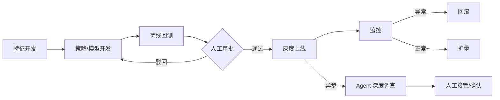

# 产品全流程与交付物清单 · V6(风控 · AI 赋能 · 终点 = Demo)

> 作品声明:本清单是个人产品能力作品的一部分,基于抽象业务场景与模拟数据,用于展示产品流程判断;不代表作者曾在原公司主导、上线或运营该产品。既往风控经验仅作为问题理解的来源。
>
> 口径说明:标注「(需核实)」的条目为需要按真实团队规则确认的项;标注「可选」的交付物可按项目裁剪。

---

## 一、V6 相对 V5 的变更(为什么改成 4 阶段)

V5 的轴是「**上线可信**」——它要证明一个真实系统可以受控上线运行,所以带上了数据基线、离线回测、上线审批、灰度扩量、运营迭代等**工程与治理环节**。

V6 的轴换成「**演示可讲**」——终点是一个**可点击的产品 Demo**。主轴一换,工程质量与治理环节不再作为独立阶段存在,而是**内化成界面上的一个字段 / 开关 / 按钮**。

| 维度 | V5 | V6 |
|---|---|---|
| 主轴 | 上线可信 | 演示可讲 |
| 阶段数 | 7 | **4** |
| 终点 | 受控上线与持续运营 | **可演示 Demo(HTML)** |
| 质量/回滚/灰度 | 独立阶段,重工程细节 | **降为功能节点,有体现即可** |
| 验收 | 上线前逐项审批 | **一道自洽验收 Gate** |

### 被「降级」的环节去哪了

| V5 独立环节 | V6 中的位置 |
|---|---|
| 数据与特征基线 | 并入阶段 3 的「特征功能」:只保留**特征策略模型开发**的功能体现 |
| 离线开发与回测 | 并入阶段 3:回测作为**功能节点**(界面上的回测按钮 + 结果页) |
| 上线准备与审批 | 并入阶段 3:上线 = 可灰度 + 可回滚 + 人工审批,作为**功能节点** |
| 灰度与扩量 | 并入阶段 3:灰度作为**页面状态**(灰度中 / 已扩量),不展开放量策略 |
| 运营与迭代 | 并入阶段 3 的「监控」功能;完整能力架构另见 V4 三列矩阵 |

> **一条硬标准(沿用)**:「**文档存在 ≠ 能力存在**」——质量、回滚、灰度这些在 Demo 里必须**看得见**(有按钮、有状态、有反馈),否则视为未体现。

---

## 二、V6 阶段序列总表(4 阶段 + 1 道 Gate)

| # | 阶段 | 核心目标 | PM 主导动作 | 交付物 |
|---|---|---|---|---|
| 1 | **场景与问题定义** | 证明值得做、为谁做 | 选场景、量化损失、定范围与角色 | 《问题定义书》《场景边界与假设清单》 |
| 2 | **需求与产品范围** | 把问题变成可验收需求 | 任务地图、需求排序、指标口径、划 Demo 范围 | 《PRD》《指标口径表》《验收标准》 |
| 3 | **核心功能闭环设计** | **特征 → 策略/模型 → 回测 → 上线** 的产品功能闭环(含至少一个 Agent 示例) | 设计功能模块;灰度/回滚/审批作为**功能节点** | 《功能清单》《各功能需求说明》 |
| 4 | **交互与原型设计** | 把功能变成可点击界面 | 信息架构、页面流程、低保真 → 高保真;同步产出演示脚本与模拟数据 | 《信息架构与页面流程图》《高保真原型》**《演示脚本》《模拟数据说明》** |
| **G** | **自洽验收 Gate** | **确认能演示、三方对得上** | 逐条勾验;发现出入回改上阶段文档并记变更 | **《Demo 自洽验收清单》** |

**Demo 形态**:HTML(单页或多页静态页)。
**必须包含**:至少 1 个 Agent 示例(如:异步深度调查 Agent)。

---

## 三、每阶段交付物清单

### 阶段 1 · 场景与问题定义

| 交付物 | 必要性 | 要点 |
|---|---|---|
| 《问题定义书》 | 必需 | 用户是谁、痛点是什么、**痛点证据来源**;不写方案 |
| 《场景边界与假设清单》 | 必需 | 不做什么、依赖什么、**哪些是假设待验证** |
| 《目标与损失量化表》 | 必需 | 目标指标必须**能下降**(非虚荣指标) |

**自检**:每条机会 ≠ 方案;无证据者标「假设待验」;含诚实声明。

---

### 阶段 2 · 需求与产品范围

| 交付物 | 必要性 | 要点 |
|---|---|---|
| 《PRD》 | 必需 | 背景目标、用户场景、**范围(做 / 不做 / Demo 范围)**、功能需求、成功标准;禁「也许/可能/待定」 |
| 《指标口径表》 | 必需 | 名称、定义、**分子/分母/时间窗/数据源/责任人** |
| 《验收标准》 | 必需 | 每场景一条 **Given/When/Then** + 量化阈值 |

**自检**:同名指标口径唯一;范围有「不做清单」;验收标准可回溯到场景编号。

---

### 阶段 3 · 核心功能闭环设计

| 交付物 | 必要性 | 要点 |
|---|---|---|
| 《功能清单》 | 必需 | 编号、名称、价值、优先级、依赖;**每个功能对应阶段 2 验收标准编号** |
| 《各功能需求说明》 | 必需 | 输入 / 处理 / 输出 / 异常态 |
| 《特征与策略功能说明》 | 必需 | **特征策略模型开发与上线**的功能体现 |
| 《发布功能说明》 | 必需 | **灰度 / 回滚 / 审批**作为功能节点:按钮、状态、反馈 |
| 《Agent 示例说明》 | 必需 | 至少 1 个 Agent:任务契约、触发条件、**人工接管规则**、失败模式 |

**功能闭环(Demo 上必须可点通)**:



**自检**:发布能力 = 一等功能节点(非「技术细节」);每个 AI 能力写明**适用边界与失败模式**;审批单一 Approver。

---

### 阶段 4 · 交互与原型设计(+ 演示脚本 + 模拟数据)

| 交付物 | 必要性 | 要点 |
|---|---|---|
| 《信息架构与页面流程图》 | 必需 | 内容清单 → 分组 → 导航;**流程含异常态、审批态、灰度态** |
| 《高保真原型》 | 必需 | 可点击;**含「页面 ↔ 功能编号 ↔ 验收标准」映射表** |
| 《演示脚本》 | 必需 | 受众目标 → **先展示结果** → 操作步骤 → 每步预期反馈 → 判断点台词 |
| 《模拟数据说明》 | 必需 | 按阶段 2 口径表生成,**每个数字可复算** |

**自检**:异常态齐全;原型过 10 条启发式(尤其「系统状态可见性」:灰度中/审批中/失败态);**数据三处标注「虚构/模拟」**(文件头 + 数据表 + 演示页)。

---

### Gate · Demo 自洽验收清单

| 验收项 | 判定标准 |
|---|---|
| 场景 ↔ 需求 | 每条需求可回溯到阶段 1 场景编号 |
| 需求 ↔ 功能 | 每个功能可回溯到阶段 2 验收标准编号 |
| 功能 ↔ 页面 | 每个功能在原型中有可点击落点 |
| 数字自洽 | 演示中每个数字可由模拟数据复算 |
| 闭环完整 | 特征→策略→回测→审批→灰度→监控 全程可点通(含异常态) |
| Agent 示例 | 至少 1 个 Agent 可演示,含人工接管 |
| 诚实声明 | 全程不暗示作者在原公司主导/上线该产品 |
| 差异回改 | 发现与上阶段出入 → **已回改上阶段文档 + 记变更** |

**判定**:全部通过 = Go;任一项不通过 = 回改对应阶段后重新验收。

---

## 四、讨论每一个问题的方法(精简版)

### 评审 3 件套

| 环节 | 做法 |
|---|---|
| **定门禁** | 上阶段交付物是输入;输入不完整 = 未 Ready,**不进入评审** |
| **定角色** | 单一 Approver(有决定权);其余人有发言权无否决权 |
| **定记录** | 每个决策用变更记录格式存档,**被取代不删除** |

### 问题清单(每阶段该问什么)

| 阶段 | 该问的问题 |
|---|---|
| 1 场景定义 | 用户是谁?痛点证据在哪?不做什么?目标指标能下降吗? |
| 2 需求范围 | 每条需求有验收标准吗?口径唯一吗?砍掉了什么? |
| 3 功能闭环 | 上线依赖什么能力(灰度/回滚/审批)?边界和失败模式是什么? |
| 4 交互原型 | 异常态画了吗?每个操作的系统反馈是什么?页面能对应到功能编号吗? |
| G 验收 | 每个数字能复算吗?三方(场景/需求/功能)对得上吗? |

### 变更记录格式(精简)

```
# DR-00N 标题(写决策,不写问题)
状态:提议 / 已接受 / 已否决 / 被取代
背景:为什么(引用上阶段交付物编号)
决策:定什么
后果:变得容易/困难的事、引入的风险
批准:单人 + 日期
```

---

## 五、待确认项(需核实)

- 各阶段具体**时长 / 人力投入**(需核实)
- **审批责任矩阵**(谁批什么)(需核实)
- 灰度**放量比例与节奏规则**(需核实)
- 回测**指标阈值与统计口径**(需核实)
- 回滚**触发阈值**(需核实)
- Demo 具体**页面数量与范围**(需核实)

---

## 六、面试 3 分钟叙事骨架(供参考)

> 选场景靠**痛点证据** → PRD 定边界 → 功能闭环把**特征/策略/回测/上线**做成可点流程 → 灰度/回滚/审批是界面上看得见的节点 → 原型 + 脚本 + 模拟数据 = 一个能讲通的 Demo。
>
> 收尾钩子:**「这条链的每一环,都让 Agent 只能辅助、不能越权。」**
