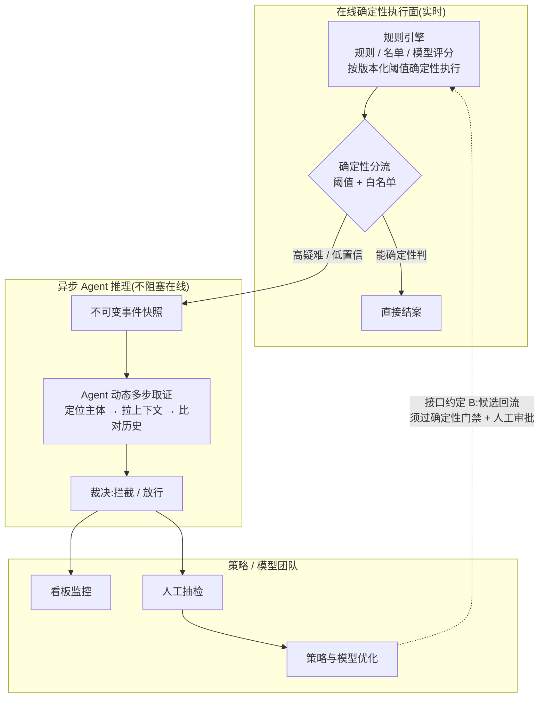

# 阶段 1:场景与问题定义

| 项 | 内容 |
|---|---|
| 版本 | v1.1 · 2026-09-14 |
| 状态 | 已放行(v1.1 冻结,2026-09-16;见 S1-DR-007) |
| 上游 | `stage-0-process/00-process-and-stages.md` |
| 本阶段要回答 | 为谁做、解决什么困难、为什么非 Agent 不可、边界在哪、架构为什么成立 |

> **说明**:本文场景为抽象设定,数据全部模拟,不代表作者曾在原公司主导、上线或运营该产品。真实系统里的量级一律标注来源。

---

## 场景



**Demo 切口**:实时命中 → 异步 Agent 深度调查。

---

## A. 问题定义

### A.1 目标用户

| 角色 | 层级 | 在本场景中的诉求 |
|---|---|---|
| 策略 / 模型团队 | 核心使用者 | 搭监控看板看实时异常;做安检分析定位问题;优化策略与模型 |
| 风控运营负责人 | 决策 | 控制积压与时效,稳定结案质量,峰值不塌 |
| 合规 / 审计 | 合规 | 决策可解释、证据链可追溯、可复核 |

角色变动说明:本场景不设一线调查员。Agent 直接出裁决,策略 / 模型团队不逐案签认,只做看板监控、抽检与策略优化。

### A.2 痛点清单

> 只写用户遇到的困难,不写方案。

| # | 痛点 | 用户角色 | 证据 |
|---|---|---|---|
| P1 | 规则引擎只能给是与否,疑难案件按确定性规则判容易误伤或漏放,靠人工补判又扩不动 | 策略 / 模型团队 | 来自既往经验,未在本项目实测 |
| P2 | 高峰期案件积压,人工吞吐见顶,高优案件可能被淹没、时效失控 | 策略 / 模型团队 | 模拟场景设定 |
| P3 | 案件数据散在名单、流水、设备、关联关系等多个系统,人工拼装取证耗时且易漏项 | 策略 / 模型团队 | 来自既往经验 |
| P4 | 人工逐笔分析无法支撑百万级/分钟的流量,只能抽样,看不全 | 策略 / 模型团队 | 模拟场景设定 |
| P5 | 分析结论与证据链散在个人笔记 / 邮件里,难回收用于策略与模型迭代 | 策略 / 模型团队 | 模拟场景设定 |
| P6 | 看板与监控缺失,策略上线后效果与异常只能事后回头翻,不能实时发现 | 策略 / 模型团队 | 来自既往经验 |

### A.3 为什么在这些案件上用 Agent,而不是继续用规则引擎

前提:在线侧**保留规则引擎**,不替换。它承担绝大部分确定性判定,低延迟、可解释、审计友好。改动只发生在一处——**把规则引擎啃不动的那部分案件交给 Agent**。

分流链路:

```
规则引擎(全量实时执行)
   ├─ 能确定性判的 → 直接结,不进 Agent
   └─ 高疑难 / 低置信的 → 生成事件快照 → 异步 Agent 推理
                                    ↓
                              动态多步取证 → 裁决:拦截 / 放行
```

**谁来分流**:规则引擎在执行时同时输出置信度与命中特征,由确定性规则(阈值 + 白名单)判定哪些案件属于"高疑难 / 低置信",这部分才进 Agent。分流本身是确定性动作,不由 Agent 决定。

为什么这部分需要 Agent:

| 方案 | 能给出的 | 给不出的 |
|---|---|---|
| 规则引擎 | 是否命中、置信度 | 证据链、条件分支、"接下来查什么" |
| 单次模型 | 一个分数 | 可复核的过程、动态工具调用 |
| Agent | 动态调用多类查询工具;中间结果有依赖、步间不可并行;过程留痕成证据链 | — |

**为 Agent 适配的数据层**:Agent 要跑得起来,上下游得改造,这不是 Agent 自己解决的:

| 项 | 要求 |
|---|---|
| 上下文查询 | 预聚合,不让 Agent 现场扫全表 |
| 工具调用 | 支持并发,可批量取数 |
| 结果格式 | 结构化,可直接拼接成证据链 |
| 吞吐与时效 | 保证分钟级出结论,不积压 |

**反事实**:如果规则引擎的确定性规则就能覆盖这批案件,或者数据层无法预聚合、必须现场扫全表,那 Agent 不成立,应该继续用规则引擎。

---

## B. 这套架构为什么成立

### B.1 三条轴线

| 层 | 角色 | 为什么这样切 |
|---|---|---|
| 在线确定性执行面(规则引擎) | 规则 / 名单 / 模型评分后按版本化阈值确定性执行 | 实时对抗可达百万级/分钟,要求执行确定性、低延迟、高吞吐;这个流量下人工逐笔确认不成立。模型本身的可解释性有限,但执行是确定的:阈值版本固定、离线评估后固化。LLM 的非确定性不适合放进热路径——这是本 Demo 基于延迟、复现与审计约束的取舍,不是行业级的绝对判断 |
| 异步 Agent 推理 | 只接过规则引擎筛出的高疑难 / 低置信案件,动态多步取证后直接裁决拦截或放行 | 深度调查耗时较长但不阻塞在线决策;Agent 的动态分支能力在这里才产生增量价值。敢让它拍板的前提是风险已被前置控住,见 C 节 |
| 策略 / 模型团队 | 不逐案签认,做看板监控、人工抽检与策略优化 | Agent 自主裁决后,人从逐案审批退到看异常率、抓样本、调策略。抽检是质量与审计的兜底 |

### B.2 双向接口约定

| 约定 | 方向 | 约束 |
|---|---|---|
| 约定 A | 在线 → 离线(事件快照) | 不可变;覆盖总体基线、抽样、独立对照与风险增补,支撑无偏评估 |
| 约定 B | 离线 → 在线(候选回流) | 必须经确定性门禁 + 人工审批;本 Demo 不做真实发布,仅示意流程 |

箭头不代表 Agent 拥有生产写权。

### B.3 论证要点

1. **AI 的价值边界被划出来**:该用 AI 的地方(疑难案件)用足,不该用的地方(全量实时执行)明确排除。这种克制本身就是判断。
2. **人力不可行性**:百万级/分钟流量下,人工逐笔确认不成立。这是异步 Agent 推理成为必需而非选项的根本原因。真正的约束是管理成本——人力规模决定人工介入必须收敛到抽检级别。
3. **异步解耦保证在线决策不被阻塞**:快照解耦加独立调查队列。
4. **Agent 敢拍板的三个前提**:①只碰规则引擎筛出的硬骨头,案件本身就处于低置信区间;②风险在命中瞬间已被确定性层控住,Agent 判错也不会漏放;③裁决可回滚,拦截后有解除与申诉路径。
5. **双向路径有门禁**:任何"从调查结论回到在线策略"的动作都要过确定性门禁加人工审批。

---

## C. 时效冲突怎么处置

> 问题:高风险事件要求分钟级处置,而 Agent 多步调查耗时数分钟。调查期间,事件怎么被临时管控?

### C.1 核心判断

处置方式跟业务场景给出的审核时间周期强相关,不是一刀切。

### C.2 分场景处置

| 场景 | 处置动作 | 用户感知 | 误伤面 | 论证 |
|---|---|---|---|---|
| 交易类 | 挂起(不下定性结论)+ 空处罚限制资金转出 | 大部分用户不感知 | 见下方估算 | 处置强度是业务场景审核周期的函数 |
| 内容类 | 进入审核周期,暂缓分发 | 用户对审核周期容忍度更高 | 低 | 内容场景时效弹性更大 |
| 通用原则 | 处置强度是业务场景审核周期的函数 | — | — | 拒绝一刀切 |

#### 估算:"大部分用户不感知"到什么程度

| 环节 | 量级(模拟) | 说明 |
|---|---|---|
| 线上风控流量 | 百万级/分钟 | 该量级下人工逐笔确认不成立,必须由确定性层自动执行加大模型 / Agent 批量确认 |
| 最终被挂起的交易占比 | 约千分之一到万分之一 | 占比极小 |
| 其中在 Agent 推理窗口(约 2 分钟)内发起转出的用户 | 更少 | 只有这部分用户会感到"交易处理中"的延迟 |

**结论**:不感知指的是大部分用户不感知,不是全部。窗口内发起转出的用户会感到交易延迟,这部分作为已接受的成本。

**这里有个需要说清的账**:占比极小不等于绝对量小。百万级/分钟乘千分之一到万分之一,被挂起的绝对量大约在每分钟一百到一千笔量级。绝对值不小,所以下面的兜底机制不是可选项。占比与影响的真实分布需要实测校准,待业务确认。

如果确实发生资金占用等实际影响,需要定义解除与申诉路径,见 C.4。

### C.3 为什么用"空处罚"而不是"直接拦截"

空处罚的意思是:冻结动作已经生效、风险被控住,但不下"违规"定性,不冤枉用户。

调查完成、Agent 裁决之后分两种走向:
- 确认风险 → 追加定性处罚
- 排除风险 → 解除管控

这样 Agent 的调查时长就跟用户损害解耦了:调查可以慢,风险不会漏。

在 Demo 里这条是可见的:用户能看到"事件被挂起 → Agent 调查中 → 结论回填 → 裁决落地",策略 / 模型团队在后台看板看到异常率与抽检结果。

### C.4 挂起兜底与风险边界

| 项 | 设计 | 说明 |
|---|---|---|
| 最长挂起时限 | 必须有上限 | 具体值待定,不允许无限期挂起 |
| 超时默认动作 | 调查超时或 Agent 失败 → 升级人工或解控 | 二选一尚未拍板,不能"挂着没人管" |
| 合规不确定性 | 账户限制的告知义务、留置期限、申诉渠道 | 多数法域对账户限制有告知、期限、申诉要求,"用户不感知"可能与告知义务冲突,待业务与合规确认 |
| 误伤怎么算 | 被挂起交易占比 × 窗口内发起转出占比 | 当前是无证据估算,须实测校准 |
| Agent 中途失败 | 需明确处置:重试 / 转人工 / 解控 | 阶段 3 细化 |

本节列的是待决策项与风险,不是已解决的结论。

---

## D. 指标

先说判断:在线实时对抗场景,产品更该关注系统稳定性和超时影响;离线场景更该关注业务运营的 AI 问题解决率。但这不是本 Demo 要解决的问题,本 Demo 要的是业务架构上的合理性,见 B 节。

所以本阶段不设北极星指标,只留一份说明性清单,用来展示我知道真实系统该看什么,并为后续阶段的可视化留接口。

### D.1 真实场景该关注什么

| 场景 | 关注方向 | 示例 |
|---|---|---|
| 在线实时对抗 | 系统稳定性、超时影响 | 超时率、P99 延迟、降级触发次数、误拦截率 |
| 离线运营 | AI 问题解决率 | 可按两种公式算:AI 直接解决的比例、转人工的比例、结论被采纳的比例 |

### D.2 不追虚荣指标

- 不用只增不减的计数类指标:累计命中数、累计调查案件数、Agent 调用次数
- 护栏型指标(一次通过率、证据链完整率)只要求不劣化,不追涨。涨到 100% 可能意味着过度取证

### D.3 目标与损失量化表(模拟)

本表是上游 stage-0 定下的阶段 1 必需交付物。定量均为模拟设定,用来展示我知道该量什么、怎么算,不构成真实承诺。

| 指标 | 定义 | 分子 | 分母 | 时间窗 | 数据源 | 责任人 | 方向 | 模拟基线 → 目标 |
|---|---|---|---|---|---|---|---|---|
| 误裁决率 | Agent 拦截后被申诉 / 抽检推翻的比例 | 被推翻裁决数 | 全部裁决数 | 周 | 抽检与申诉记录(模拟) | 策略 / 模型团队 | 应下降 | 模拟值 → 下降 30%(模拟) |
| 单案推理时长 | 从进入 Agent 到输出裁决的耗时 | Σ推理分钟 | 完成裁决数 | 周 | 队列日志(模拟) | 策略 / 模型团队 | 应下降 | 模拟值 → 下降 50%(模拟) |
| 疑难案件分流准确率 | 确实需要深度分析的案件占进入 Agent 案件的比例 | 确需深度分析数 | 进入 Agent 案件数 | 周 | 抽检标注(模拟) | 策略 / 模型团队 | 应上升,但不追高 | 模拟值 |
| 证据链完整率 | 关键取证项被完整留痕的占比 | 完整覆盖案件数 | 全部案件数 | 周 | 证据链视图(模拟) | 策略 / 模型团队 | 护栏,不下降 | 模拟值 |

**损失量化(模拟)**

| 损失项 | 计算方式 | 量级 |
|---|---|---|
| 积压损失 | 超时案件数 × 平均延迟时长 | 模拟量级 |
| 人力损失 | 人工抽检与申诉处理时长 × 人员综合时薪 | 模拟量级 |
| 误伤/成本损失 | 被挂起交易占比 × 窗口内转出占比 × 单笔影响 | 需实测校准 |
| 复核返工损失 | 退回案件数 × 平均返工时长 | 模拟量级 |

维度为什么选这些:本 Demo 主轴是"演示可讲",上表不作为 Demo 的验收标准。保留它是为了让"这件事值得做"有可追查的算法,而不是在指标上做产品。

### D.4 演示用指标(预留)

以下为演示用说明性指标,非真实承诺:

| 指标 | 定义 | 方向 | 备注 |
|---|---|---|---|
| 误裁决率 | Agent 拦截后被申诉 / 抽检推翻的比例 | 应下降 | 演示用 |
| 单案推理时长 | 从进入 Agent 到输出裁决的耗时 | 应下降 | 演示用 |
| 疑难案件分流准确率 | 确实需要深度分析的案件占进入 Agent 案件的比例 | 应上升,但不追高 | 演示用 |
| 证据链完整率 | 关键取证项被完整留痕的占比 | 护栏,不下降 | 演示用 |

---

## E. 边界与非目标

### E.1 做什么

| 范围项 | 内容 |
|---|---|
| 在线侧(确定性) | 演示规则 / 名单 / 模型命中高风险事件 → 生成事件快照 → 触发异步调查任务 |
| 离线调查 Agent | 异步多步调查:取事件上下文 → 调用模拟工具 → 证据聚合 → 输出结构化结论与置信度 |
| AI 风控看板与工作台 | 任务队列、Agent 推理进度与证据链视图、异常率监控、人工抽检入口 |
| 时效处置 | 演示"挂起 + 空处罚"机制及分场景处置逻辑,见 C 节 |
| 回流示意 | 调查结论可标记为"候选回流",演示止于门禁 + 人工审批示意 |

### E.2 不做什么

| # | 非目标 |
|---|---|
| N1 | 不做真实生产部署:不上线、不接真实数据、不做真实模型训练 |
| N2 | 不让生成式 LLM / 开放 Agent 进入在线实时热路径的命中决策 |
| N3 | Agent 对进入推理的案件**直接裁决拦截 / 放行**。前提是:案件属于规则引擎筛出的高疑难 / 低置信区间,且命中瞬间的临时管控(挂起 / 空处罚)已由确定性层自动执行。裁决可回滚,拦截后有解除与申诉路径 |
| N4 | 不做 Agent 自身安全方向(本方向是用 AI 做风控) |
| N5 | 不做候选回流真实发布,仅做流程示意 |
| N6 | 不展开监管制度映射(EU AI Act / OCC / 中国监管)、字段 / 接口 / 表结构、供应商选型与费率 |
| N7 | 不以任何真实公司、真实指标、真实上线经历做背书 |
| N8 | 不承诺上线可信性,主轴是"演示可讲" |

---

## F. 待验证清单

| # | 待验证项 | 性质 | 怎么验 |
|---|---|---|---|
| A1 | 调查存在三个以上相互依赖的取证步骤 | 假设 | 访谈调查员并拆解样本案件 |
| A2 | 信息查找与整理占用显著人工时间 | 假设,待业务确认 | 时间日志或跟岗抽样 |
| A3 | Agent 预分析可减少有效人工时长 | 假设,待业务确认 | 同源案件盲测对照 |
| A4 | 结构化证据链可降低复核退回 | 假设,待业务确认 | 比较人工流程与 Demo 流程 |
| A5 | 人工能够识别证据缺失和错误引用 | 假设 | 设置故障样本进行盲审 |
| A6 | 约定 A 的样本可支持无偏评估 | 假设 | 检查覆盖率及分层分布差异 |
| A7 | 调查的多步性可被结构化表达为"工具调用 + 中间结果依赖" | 假设 | Demo 走查时由同行评审判断 |
| A8 | "空处罚"在真实场景中可被用户与监管接受 | 假设,待业务确认 | 需业务与合规确认 |
| A9 | 被挂起交易占比在千分之一到万分之一量级 | 假设,待业务确认 | 需实际漏斗数据校准 |
| A10 | Agent 多步调查耗时在分钟级(约 2 分钟量级) | 假设,待业务确认 | 需实测推理耗时 |
| A11 | 百万级/分钟流量下人力逐笔人工确认不可行 | 来自既往经验,待业务确认 | 需与业务确认实际流程 |

---

## G. 最可能的失败点

| # | 失败点 | 应对(在后续阶段体现) |
|---|---|---|
| 1 | 自动化悖论:结论不可信,复核成本不降反升 | Demo 必须体现"证据可追溯、遗漏可发现" |
| 2 | 模拟工具太浅,查不到"多步依赖"分支,退化成套壳查询界面 | Demo 必须含"查不到"路径与条件分支 |
| 3 | 异步形态与处置时效冲突 | 方向已定(见 C 节分场景处置);最长挂起时限、超时放行、合规告知义务仍是开放风险,见 C.4 |
| 4 | 步骤无法工具化,隐性经验拆不出来,Agent 沦为演示专用脚本 | 阶段 3 需明确工具边界与失败分支 |
| 5 | Agent 自主裁决的责任归属不清,或抽检流于形式,质量失控 | 阶段 3 需明确人工抽检比例、推翻机制与回溯通道 |

---

## H. 免责说明

本作品为个人能力展示。场景为抽象设定,数据全部模拟,交付物为可点击 HTML Demo,不构成任何真实系统的能力或效果声明。

---

## 变更记录

| 编号 | 日期 | 变更 | 理由 |
|---|---|---|---|
| S1-DR-001 | 2026-09-14 | 场景定为「在线确定性执行面 → 异步 Agent 深度调查 → 人工签认」 | 沿用 V4,作者明确沿用场景 |
| S1-DR-002 | 2026-09-14 | 「异步时效冲突」写进阶段 1,给出分场景处置方案 | 作者拍板:写进;补充交易=空处罚冻结、内容=长周期容忍、处置=审核周期的函数 |
| S1-DR-003 | 2026-09-14 | 北极星指标降级为说明性指标,B 节升为本阶段核心结论 | 作者判断:实时场景应看稳定性/超时影响,离线应看 AI 问题解决率,但这不是本 Demo 要考虑的问题;本 Demo 要的是业务架构合理性 |
| S1-DR-004 | 2026-09-14 | 首轮三方评审后修订:①「用户不感知」改为「大部分用户不感知」+ 估算表;②建立「临时管控 vs 最终定性处置」两级术语,修 N3;③新增 C.4 挂起兜底与风险边界;④补回目标与损失量化表 | 三方评审一致判定 Not Ready,阻塞项三条。指标降级可保留,但不得删除 stage-0 必需交付物 |
| S1-DR-005 | 2026-09-14 | 澄清执行主体:线上流量级下人力人工确认不可行,改为确定性层自动执行 + 大模型/Agent 确认;管理成本是真约束 | 作者纠正:百万级/分钟流量下不存在人力人工确认;这是异步 AI 调查成为必需的根本论证 |
| S1-DR-006 | 2026-09-15 | 应用 `pm-writing` skill 去 AI 味改写:①删文首重复免责,合并到 H 节一条;②标题去掉"定稿/锁定/核心结论/高光"等状态仪式与自夸;③「契约」改「接口约定」;④`(需核实)`/`[假设]` 分级为"待业务确认/假设/来自既往经验";⑤补绝对量说明(每分钟一百到一千笔);⑥修"分母极小"为"占比极小" | 作者反馈:文档 AI 味重,正常人类不这样写。事实、数字、结论、变更记录一律未改 |
| S1-DR-007 | 2026-09-16 | 阶段 1 放行:交付物冻结为 v1.1,关闭本阶段,阶段 2 以其为唯一输入 | 三方复评中 Codex 判 Not Ready,其理据是用已上线系统的数据可信度标准,要求一个尚未上线的原型场景提供实测依据。作者认定该尺度与本阶段定位(证明值得做、为谁做)不匹配,不作为阻塞项,仅保留评审留痕 |
| S1-DR-008 | 2026-09-16 | 明确"量级取舍"的评审尺度:本项目为原型作品,验收尺度是功能与流程是否合理,不是数据是否可复现;对规模化系统的取舍只要求"影响被识别并作为已接受成本披露",不要求消除 | 立规矩:后续评审不得用上线期数据标准评判定型期文档,避免同一问题反复阻塞 |
